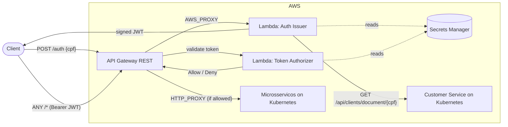
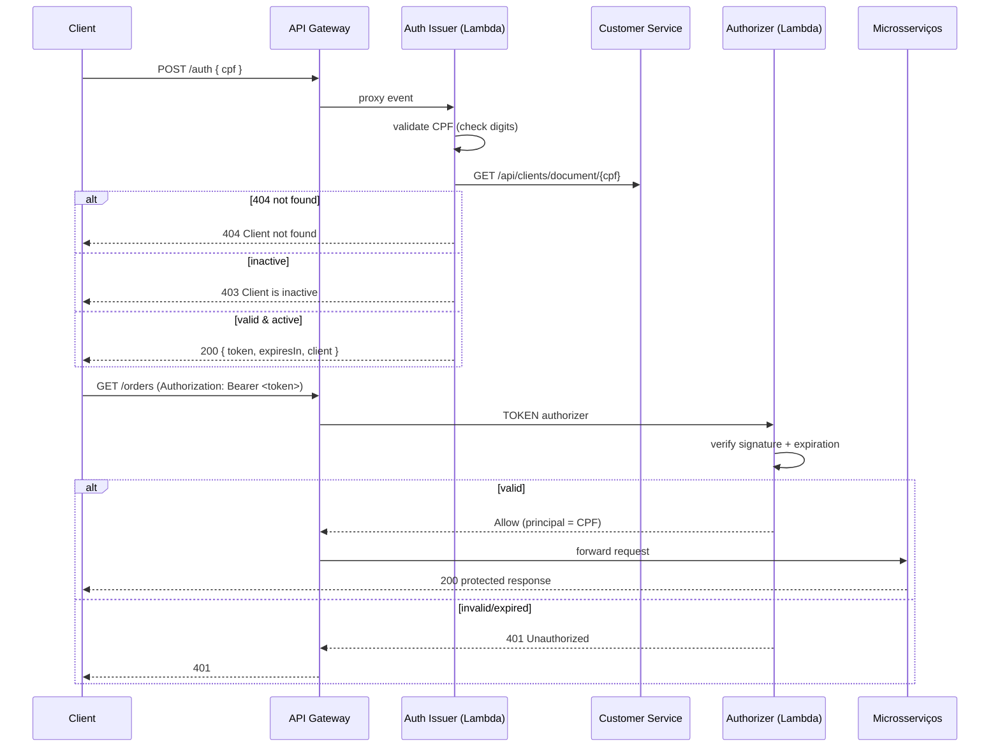

# workbench-lambda

# workbench-lambda

Serverless **authentication** da plataforma **Workbench** (FIAP SOAT — Tech
Challenge Fase 4). Microsserviço serverless que autentica **clientes (por CPF)** e
**staff (por e-mail/senha)** e emite o JWT usado em toda a plataforma de microsserviços.

> **Contexto (Fase 4):** na Fase 3 a autenticação servia o monólito e lia a tabela
> `clients` direto no banco. Na Fase 4, com a refatoração em microsserviços e o
> requisito de **isolamento de banco**, o issuer deixou de acessar banco e passou a
> resolver o cliente **por REST no Customer Service** (`GET /api/clients/document/{cpf}`).
> O token emitido é verificado por **todos os microsserviços** (mesmo `JWT_SECRET`).

This repository contains the AWS Lambda functions and the Terraform/CI‑CD needed to:

1. **Issue tokens** — validate a client's CPF, confirm the client exists and is **active** in the database, and return a signed **JWT**.
2. **Authorize requests** — validate that JWT on protected API Gateway routes before traffic reaches the microservices.

---

## Responsibilities (two functions, one contract)

| Function | Handler | Role |
|---|---|---|
| **Auth issuer (cliente)** | `com.workbench.workshop.auth.AuthHandler` | `POST /auth` — validates CPF, checks client status via the **Customer Service (REST)**, **issues** a client JWT (`roles:[CLIENT]`, claim `clientId`). Runs in the VPC. |
| **Staff issuer** | `com.workbench.workshop.auth.StaffAuthHandler` | `POST /auth/login` — valida e-mail/senha no **Customer Service** (`POST /api/users/auth/validate`) e emite um JWT de **staff** (roles ADMIN/TECHNICIAN, **sem** `clientId`). Paridade com o login de staff do monólito. Roda na VPC. |
| **Token authorizer** | `com.workbench.workshop.auth.TokenAuthorizerHandler` | API Gateway `TOKEN` authorizer — **validates** the JWT on protected routes. No DB access. |

Both sign/verify with the **same shared `JWT_SECRET`** (HS256), so tokens issued here are verifiable across the platform.

> The issuer only *issues*; the authorizer only *validates*. A client authenticates once at `/auth`, then sends `Authorization: Bearer <token>` on every protected call.

---

## Technologies

- **Java 21**, Maven (fat jar via `maven-shade-plugin`)
- **jjwt 0.13.0** (HS256) — same library/version as the main app
- **Customer Service (REST)** — client lookup via `GET /api/clients/document/{cpf}`
  (the clients table moved to the Customer Service in Fase 4, Etapa 6; the Lambda
  no longer touches any database — ADR-0003)
- **AWS Lambda** (functions) — provisioned with **Terraform**. The API Gateway that
  fronts these functions lives in the **`workbench-gateway`** repo and references
  them via `terraform_remote_state`.
- **AWS Secrets Manager** — managed store for `JWT_SECRET` and the Customer Service URL
- **GitHub Actions** — CI (test + `terraform validate`) and CD (`develop` and `main` both deploy)

---

## Architecture



### Authentication sequence



---

## API

### `POST /auth`

Request:

```json
{ "cpf": "529.982.247-25" }
```

CPF is accepted formatted or as raw digits.

Responses:

| Status | Body | Meaning |
|---|---|---|
| `200` | `{ "token": "...", "expiresIn": 86400000, "client": { "id": 1, "name": "JOAO DA SILVA" } }` | Authenticated |
| `400` | `{ "error": "Invalid CPF" }` / `{ "error": "CPF is required" }` | Bad/missing CPF |
| `404` | `{ "error": "Client not found" }` | No client with that document |
| `403` | `{ "error": "Client is inactive" }` | Client exists but is deactivated |

The JWT payload:

```json
{
  "sub": "52998224725",
  "clientId": 1,
  "name": "JOAO DA SILVA",
  "roles": ["CLIENT"],
  "iat": 1690000000,
  "exp": 1690086400
}
```

### `POST /auth/login` (staff)

Login de staff por e-mail/senha. A Lambda valida as credenciais no Customer Service
(`POST /api/users/auth/validate`) e emite o JWT de staff.

Request:

```json
{ "email": "admin@workbench.dev", "password": "admin123" }
```

Responses:

| Status | Body | Meaning |
|---|---|---|
| `200` | `{ "token": "...", "expiresIn": 86400000, "email": "...", "roles": ["ADMIN"] }` | Autenticado |
| `400` | `{ "error": "Email and password are required" }` | Campos ausentes |
| `401` | `{ "error": "Invalid credentials" }` | E-mail/senha inválidos |
| `500` | `{ "error": "Internal error" }` | Falha ao consultar o Customer Service |

JWT de staff (note a ausência de `clientId` — é assim que os serviços distinguem
staff de cliente):

```json
{ "sub": "admin@workbench.dev", "roles": ["ADMIN"], "iat": 1690000000, "exp": 1690086400 }
```

### Postman / Bruno

Collection da plataforma (com login de cliente e de staff) em
`workbench-technical-documentation/postman`. Aponte a `baseUrl` para a stage URL do
API Gateway (output do repo **`workbench-gateway`**).

---

## Build & test locally

```bash
./mvnw clean verify        # compile + run unit tests
./mvnw package             # build the Lambda fat jar (target/workbench-lambda.jar)
```

## Deploy (Terraform)

Prerequisites: an S3 bucket for remote state and a VPC with subnets/security groups that can reach the **Customer Service** in-cluster.

```bash
cd terraform
cp terraform.tfvars.example terraform.tfvars   # fill in real values (never commit)

terraform init \
  -backend-config="bucket=<state-bucket>" \
  -backend-config="key=lambda/develop/terraform.tfstate" \
  -backend-config="region=us-east-1"

terraform apply
```

Key outputs: `issuer_invoke_arn`, `staff_issuer_invoke_arn`, `authorizer_invoke_arn`
(consumed by the gateway repo).

### Environment variables consumed by the functions

| Variable | Function | Purpose |
|---|---|---|
| `CUSTOMER_SERVICE_URL` | issuer | base URL of the Customer Service (CPF lookup via REST) |
| `JWT_SECRET` | issuer + authorizer | HS256 sign/verify (shared) |
| `JWT_EXPIRATION` | issuer | token lifetime (ms, default 86400000) |

---

## CI/CD

- **Branch protection:** `main` and `develop` — no direct commits; merges via Pull Request.
- **CI** (`.github/workflows/ci.yml`): on PRs to `develop`/`main` and on `feature/**` pushes — runs Java tests and `terraform fmt`/`validate`.
- **CD** (`.github/workflows/cd.yml`): on push to `develop` and on push to `main` — packages the jar and runs `terraform apply`. The branch name is used as the environment (no GitHub Environments needed), matching the workbench-monolith flat repo-secret convention.

### Network

The issuer runs inside the VPC (subnets + security group passed as explicit inputs)
so it can reach the **Customer Service** running in the EKS cluster. The security
group must allow egress to the Customer Service endpoint (in-cluster Service DNS or
an internal LoadBalancer). The authorizer needs no VPC (it only verifies JWTs).

### Required GitHub configuration (reused from workbench-monolith)

Repo **variables**: `TF_STATE_BUCKET`, `AWS_REGION`.

Repo **secrets**: `AWS_ACCESS_KEY_ID`, `AWS_SECRET_ACCESS_KEY`, `JWT_SECRET`,
`CUSTOMER_SERVICE_URL_DEVELOP`/`CUSTOMER_SERVICE_URL_MAIN`,
`SUBNET_IDS_*`, `VPC_SECURITY_GROUP_IDS_*`.

> `JWT_SECRET`, `TF_STATE_BUCKET`, `AWS_REGION` and the AWS keys use the **same
> names and values** as workbench-monolith — reuse them. The database secrets
> (`DB_*`) are **no longer needed**: the issuer resolves the client via the Customer
> Service REST API. The backend URL (`ORIGIN_URL`) lives in the **`workbench-gateway`** repo.

---

## Observability

Both functions emit **one-line JSON logs** to CloudWatch (`level`, `event`, `requestId`, `function`, …).
`requestId` is the Lambda request id and lets a single call be traced across the API Gateway
access log → authorizer → issuer. CPF/CNPJ values are always masked (`529******25`).

The token authorizer returns an Allow policy scoped to the whole API stage (`…/<stage>/*/*`)
rather than the single method ARN, so API Gateway can cache the authorizer result
(`authorizer_result_ttl_in_seconds`) without denying every route after the first call.

## Integração com os microsserviços (required)

Uma chamada protegida só funciona se os **microsserviços** souberem aceitar este token.
Cada serviço roda um filtro de segurança que reconhece o token de cliente (subject =
CPF/CNPJ, claim `clientId`, sem linha em `users`), concede `ROLE_CLIENT` e resolve o
cliente por documento. Todos os serviços compartilham o mesmo **`JWT_SECRET`** (HS256),
então o token emitido aqui é verificável em qualquer um deles (ver `SecurityConfig` /
`JwtFilter` de cada serviço).

## Notes

- Remember to add the **`soat-architecture`** user to this repository (Tech Challenge delivery requirement).
- Secrets are managed in AWS Secrets Manager and injected as Lambda environment variables so the function code stays runtime-agnostic; fetching them at runtime via the AWS SDK is a straightforward future hardening.
- Client vs staff tokens are distinguished by the `clientId` claim: client tokens
  carry it (and `roles:[CLIENT]`); staff tokens omit it and carry the real roles
  (ADMIN/TECHNICIAN). `iss`/`aud` claims are not stamped yet — a low-effort hardening.
